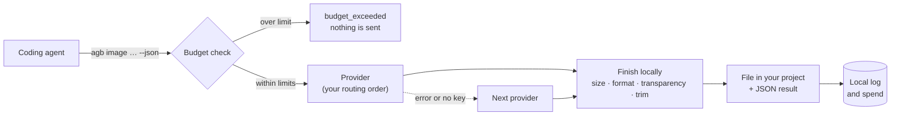

<p align="center">
  <picture>
    <source media="(prefers-color-scheme: dark)" srcset="assets/brand/agentbridge-logo-dark.svg">
    
  </picture>
</p>

<p align="center">
  <strong>The asset department for your coding agent.</strong><br>
  Ready-to-use images, icon sets, sound effects and voice lines, made with your own AI keys,<br>
  sized and cleaned up for your project, within a budget you control.
</p>

<p align="center">
  <a href="docs/getting-started.md">Getting started</a> ·
  <a href="docs/guide.md">Guide</a> ·
  <a href="docs/commands.md">Commands</a> ·
  <a href="docs/configuration.md">Configuration</a> ·
  <a href="CHANGELOG.md">Changelog</a>
</p>

---

```bash
agb style init
agb image "pixel art sword" --out assets/sword.png --size 64x64 --transparent --trim
agb icon-set "a friendly rocket" --out-dir public --preset web
agb audio "short metallic UI click" --out assets/click.wav --duration 0.5
```

## The problem

Coding agents such as Claude Code, Codex and Cursor write code well, but a real project also needs
assets: an icon for the settings screen, a sprite for the game, a favicon, a click sound. Today the
agent leaves a placeholder and the work stops until a person makes the file.

Calling an image model directly does not solve this either. What a model returns is rarely what the
project needs:

| The project needs | What an image model gives you |
|---|---|
| A 64×64 sprite | A 1024×1024 picture |
| A transparent background | A white or colored background |
| A `.webp` or `.jpg` file | Whatever format the model produces |
| A favicon set: `.ico`, 16, 32, 180, 192 and 512 px, a manifest | One image |
| Assets that look like they belong together | A different style on every call |
| Assets in a consistent place, at a known cost | A URL or base64 blob and a surprise bill |

## What agentBridge does

agentBridge gives your agent a single command, `agb`, that turns a request into a **finished file in
your project**:

1. **Generates** the content with the provider you prefer: OpenAI, Google Gemini, ElevenLabs or any of
   the hundreds of models on OpenRouter.
2. **Keeps one look**: the project's style profile (description, palette, things to avoid and a
   reference image) is applied to every image, whichever agent asks for it.
3. **Finishes** it locally: exact size, the format your file name asks for, a transparent background
   with any provider, trimmed margins, complete icon sets.
4. **Saves** it at the path you gave and reports the result as JSON the agent can act on.
5. **Guards** your wallet: daily, per-project and per-call limits are checked before anything is sent,
   and every call is logged with its cost.

The agent only needs to know what it wants. Which provider makes it, how it is resized and whether the
budget allows it is handled for it.

### How is this different from OpenRouter?

OpenRouter gives *developers* one API for many models and returns whatever the model produced.
agentBridge is for *coding agents* and delivers a usable asset: the right size, format and
transparency, saved into the project, with a spending limit in front of it. The two work together:
OpenRouter is one of agentBridge's providers.

## Features

| | |
|---|---|
| **Exact sizes** | `--size 64x64` gives exactly 64×64 pixels, cropped or padded the way you choose with `--fit`. |
| **Transparency everywhere** | `--transparent` works with every image provider, not only those that support it natively. |
| **One look per project** | A style profile in `agentbridge.toml` is applied to every image and its reference image is sent to the provider, so assets made by different agents on different days still match. |
| **Icon sets** | `agb icon-set` writes a complete favicon or app icon set, including `.ico` files, a web manifest and the HTML tags. |
| **Free local processing** | `agb process` resizes, converts, trims or removes the background of images you already have. |
| **Any format** | The output file name decides the format: `.png`, `.jpg`, `.webp`, `.mp3` or `.wav`. |
| **Your providers, your order** | OpenAI, Gemini, ElevenLabs and OpenRouter, tried in the order you set, with automatic fallback. |
| **Spending limits** | Limits are enforced before a request is sent, even with several agents running in parallel. |
| **Built for agents** | Stable JSON results, error codes and exit codes, plus ready-made instructions for your agent. |
| **Keys stay on your machine** | Stored in the operating system keychain, never printed or logged. |

## Quick start

Install with Cargo (Rust 1.88 or newer):

```bash
cargo install --locked --git https://github.com/cekdarcpr/AgentBridge agentbridge-cli
```

Add a key for at least one provider and check it:

```bash
agb keys set openai
agb keys test openai
```

Make your first asset, preview it for free with `--dry-run` first if you like:

```bash
agb image "pixel art sword icon" --out assets/sword.png --size 64x64 --transparent --dry-run
agb image "pixel art sword icon" --out assets/sword.png --size 64x64 --transparent
```

To give every image in the project the same look, create a style profile and edit it:

```bash
agb style init
```

Then teach your agent to use it. This adds the [agent instructions](docs/agent-instructions.md) to your
project's `CLAUDE.md` or `AGENTS.md`:

```bash
agb agent init
```

From then on, a request like *"add a sword icon and a
click sound to the inventory screen"* is enough.

The full walkthrough is in [Getting started](docs/getting-started.md).

## How it works



Read more in [How it works](docs/concepts.md).

## Providers

| Provider | Images | Sound effects | Speech | Text |
|---|:---:|:---:|:---:|:---:|
| [OpenAI](https://platform.openai.com/api-keys) | ✓ | | ✓ | ✓ |
| [Google Gemini](https://aistudio.google.com/apikey) | ✓ | | ✓ | ✓ |
| [ElevenLabs](https://elevenlabs.io/app/settings/api-keys) | | ✓ | ✓ | |
| [OpenRouter](https://openrouter.ai/settings/keys) | ✓ | | ✓ | ✓ |

One key is enough to start: an OpenRouter key alone covers images, speech and text. Add more for
choice and fallback. Sound effects need ElevenLabs, the only provider with a sound effect API. Default
models and the order in which providers are tried are listed in [Configuration](docs/configuration.md).

## Documentation

| Page | What you will find |
|---|---|
| [Getting started](docs/getting-started.md) | Install, add keys, make a first asset and connect your agent, step by step. |
| [Guide](docs/guide.md) | Recipes: a project style, game sprites, UI icons, favicons, app icons, banners, sounds, voice lines. |
| [How it works](docs/concepts.md) | Routing and fallback, the asset pipeline, transparency, consistent style, budgets and privacy. |
| [Commands](docs/commands.md) | Every command and option, the JSON output and the error codes. |
| [Configuration](docs/configuration.md) | Routing, default models and voices, the project style, limits, prices and environment variables. |
| [Agent instructions](docs/agent-instructions.md) | The text `agb agent init` adds to `CLAUDE.md` or `AGENTS.md`. |

## Development

```bash
cargo build
cargo test --workspace
cargo clippy --workspace --all-targets
```

See [CONTRIBUTING.md](CONTRIBUTING.md) for guidelines and [SECURITY.md](SECURITY.md) to report a
vulnerability privately. Tests never contact a provider. They cover dry runs, validation, budgets and the complete local image
pipeline.

| Crate | Contents |
|---|---|
| [`crates/agentbridge-core`](crates/agentbridge-core) | Providers, routing, image processing, icon sets, style profiles, budgets, keychain and the call log |
| [`crates/agentbridge-cli`](crates/agentbridge-cli) | The `agb` command-line interface |

agentBridge is developed and tested on Windows. macOS and Linux are supported by the code but not yet
tested; reports are welcome. Issues and pull requests are welcome too.

## License

Licensed under either of

- [Apache License, Version 2.0](LICENSE-APACHE)
- [MIT License](LICENSE-MIT)

at your option.

Unless you explicitly state otherwise, any contribution intentionally submitted for inclusion in the work
by you, as defined in the Apache-2.0 license, shall be dual licensed as above, without any additional
terms or conditions.
