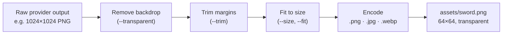

# How it works

This page explains what happens between an agent running `agb` and a file appearing in the project:
how a provider is chosen, how a raw generation becomes a finished asset, and how spending is kept
under control.

- [Capabilities, not providers](#capabilities-not-providers)
- [Routing and fallback](#routing-and-fallback)
- [The asset pipeline](#the-asset-pipeline)
- [Transparency with any provider](#transparency-with-any-provider)
- [Consistent style](#consistent-style)
- [Budgets](#budgets)
- [Cost tracking and the call log](#cost-tracking-and-the-call-log)
- [Keys, privacy and security](#keys-privacy-and-security)

## Capabilities, not providers

An agent asks for a **capability**, never for a vendor:

| Capability | Command |
|---|---|
| Image | `agb image`, `agb icon-set` |
| Sound effect | `agb audio` |
| Speech | `agb speech` |
| Text | `agb ask` |

This keeps the instructions in your project independent of any provider. You can switch from OpenAI to
Gemini, add OpenRouter or remove a key, and every agent keeps working without being told.

## Routing and fallback

For each capability you keep an ordered list of providers, the **routing**. The defaults are:

| Capability | Tried in this order |
|---|---|
| Image | OpenAI → Google Gemini → OpenRouter |
| Sound effect | ElevenLabs |
| Speech | ElevenLabs → OpenAI → Google Gemini → OpenRouter |
| Text | Google Gemini → OpenAI → OpenRouter |

When a call is made:

1. Providers without an API key are **skipped**.
2. The first provider with a key is called.
3. If it is **busy** (HTTP 429) or has a temporary server error (500, 502, 503, 504), the same request
   is retried up to two more times, waiting 1 then 2 seconds, or as long as the provider's
   `Retry-After` header asks, up to 20 seconds. Timeouts are not retried, because the provider may
   still finish and bill the first request.
4. If it still **fails**, for example because it is down, out of credit or rejects the prompt, the
   next one is tried.
5. The JSON result lists every provider that was considered in `attempts`, and `fallback_used` tells
   the agent whether the first choice was replaced.

Fallback is turned off with `--no-fallback`, or implicitly when the agent pins a provider with
`--provider` or a model with `--model`. Change the order in the [configuration](configuration.md#routing).

## The asset pipeline

Every image goes through the same steps before it is saved. The steps run locally, after the provider
has answered, and cost nothing:



| Step | Option | What it does |
|---|---|---|
| Remove backdrop | `--transparent` | Makes a flat background transparent; see the next section. |
| Trim | `--trim` | Crops transparent margins so the subject fills the frame. |
| Fit | `--size WxH` with `--fit` | Produces exactly the requested size. |
| Encode | file extension | Writes `.png`, `.jpg` or `.webp`; JPEG is placed on white because it has no transparency. |

The three fit modes:

| `--fit` | Result | Default for |
|---|---|---|
| `cover` | Fills the whole frame; overflow is cropped from the center. | Opaque images |
| `contain` | Keeps the whole image; the rest is padded, transparent if the format allows, white otherwise. | Transparent images |
| `stretch` | Scales to the exact size, ignoring the aspect ratio. | |

When the requested size is larger than what the provider generated, the image is upscaled and the
result includes a warning, because fine detail may look soft. If nothing needs to change, the
provider's file is saved byte for byte.

`agb process` runs exactly this pipeline on an image you already have, and `agb icon-set` uses it to
produce each icon size.

## Transparency with any provider

Few image models can return a real transparent background, and the ones that can are not always the
ones you want to use. agentBridge handles it in one of two ways:

- **Native:** providers that support transparency, currently OpenAI, are asked for it directly.
- **Backdrop removal:** every other provider is asked to draw the subject on a solid, flat magenta
  background. agentBridge then removes that color starting from the edges of the image, so
  magenta-colored details inside the subject are kept. Anti-aliased edges are un-blended: each edge
  pixel becomes partly transparent and the magenta tint is taken out of its color, which avoids the
  colored halo that simple color keys leave behind.

If a provider ignores the instruction and draws a busy background, the image is saved unchanged and the
result includes a warning instead of a damaged cut-out.

## Consistent style

Images generated one at a time drift apart: a different palette, line weight or level of detail on
every call, even with the same provider. A project **style profile** keeps them together. It lives in
`agentbridge.toml` at the project root:

```toml
[style]
description = "pixel art, 16-bit, limited shading, dark outline"
palette = ["#1A1C2C", "#5D275D", "#B13E53", "#EF7D57", "#FFCD75"]
avoid = "text, gradients, photorealism"
reference = "assets/sprites/hero.png"
```

Every `agb image` and `agb icon-set` call made in the project then:

1. **Adds the style to the prompt** after the subject: the description, the palette and what to avoid.
   The agent only describes *what* to draw.
2. **Sends the reference image** with the request, asking the model to match its style without copying
   its subject. Providers that take image input receive it directly: OpenAI, Gemini and OpenRouter.
   The reference is downscaled to 1024 pixels first to keep the request small.
3. **Reports the style file** it applied in the `style` field of the result.

Because the profile is a file in the repository, every agent, teammate and session uses the same
style, and changing the look of a project is a one-line change. Pass `--no-style` for a single image
that should not follow it, such as a photo-like banner.

> [!TIP]
> The strongest reference is an asset you already like from the same project. Generate a first image,
> keep the best one and point `reference` to it.

## Budgets

Three limits protect you from runaway spending:

| Limit | Default | Applies to |
|---|---|---|
| `daily_usd` | $5.00 | All calls on one calendar day |
| `project_daily_usd` | $2.00 | All calls from one project on one day |
| `max_call_usd` | $1.00 | Any single call |

- **Checked before sending.** The estimated cost of the call is compared with every limit before
  anything leaves your machine, so a refused call costs nothing. The agent receives the error code
  `budget_exceeded` and is instructed to stop and ask you.
- **Safe with parallel agents.** While a call is running it counts at its estimated cost, so several
  agents starting at once cannot all pass the same check and overshoot together.
- **Projects** are identified by the git repository the agent runs in. Use `--project` or
  `AGENTBRIDGE_PROJECT` to set a name yourself.

## Cost tracking and the call log

Every request sent to a provider is recorded in a local database with its provider, model, prompt,
output path, status, duration and cost. `agb usage` and `agb log` read from it.

Costs are recorded as accurately as each provider allows:

| Source | Used when | `cost_is_estimate` |
|---|---|:---:|
| The amount the provider billed | OpenRouter reports it for its calls (for speech, when its statistics are ready in time) | `false` |
| Token usage × token prices | The provider reports token usage and prices are known | `false` |
| The price table | Neither of the above | `true` |

Failed calls are recorded at zero cost. A model with no known price is counted at $0.10 per call so
that it can never spend unnoticed; add its real price in the [configuration](configuration.md#prices).

> [!IMPORTANT]
> Built-in prices are approximate list prices and can be out of date. Check your providers' pricing
> pages and override them in the configuration when accuracy matters.

## Keys, privacy and security

- **Keys live in the operating system keychain:** Windows Credential Manager, macOS Keychain or the
  Secret Service on Linux, under the name `agentbridge`. Environment variables such as
  `OPENAI_API_KEY` are used only when no key is stored.
- **Keys are never displayed or passed as arguments.** `agb keys set` reads from the keyboard or
  stdin, so keys stay out of shell history. `agb keys list` shows only where a key comes from.
  Keys are redacted from provider error messages before those are shown or logged.
- **Your prompts go only to the provider that handles the call.** agentBridge has no server of its
  own and collects no telemetry. `agb process` and `agb icon-set --from` send nothing anywhere.
- **The call log stays on your machine.** It contains your prompts; delete the database file shown by
  `agb config path` to clear it. Files attached with `agb ask --file` are sent to the model but never
  written to the log.
- **A style reference never leaves the project.** The `reference` image in `agentbridge.toml` must be
  inside the project folder, so a style file in a cloned repository cannot make agb upload an image
  from elsewhere on your machine.
